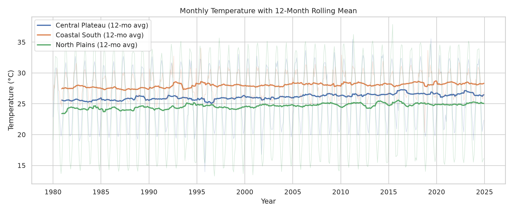
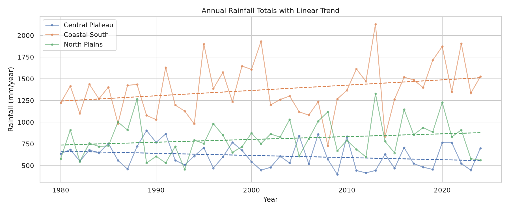
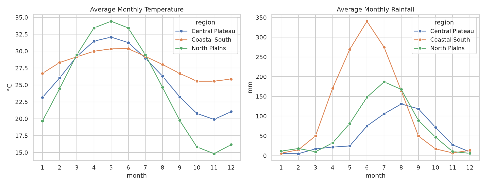
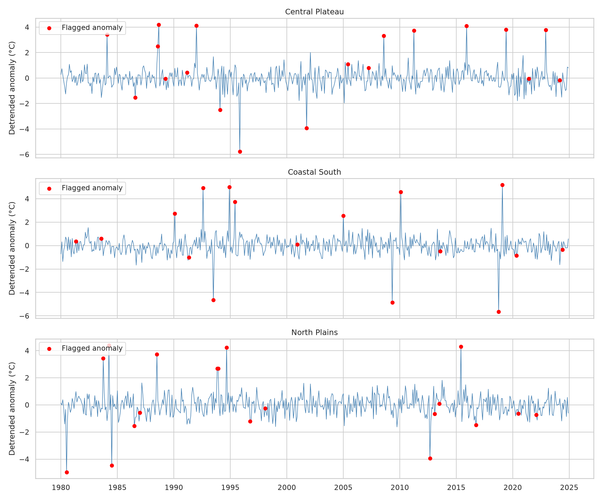
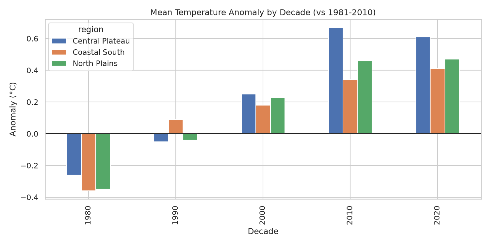
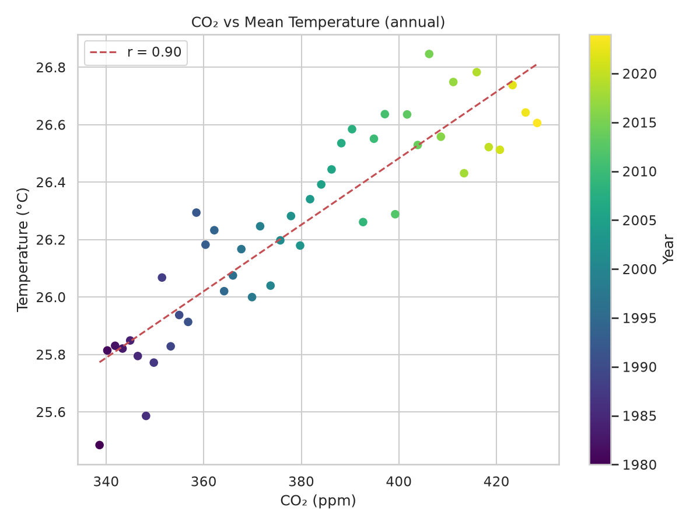

# 🌍 Climate Trend Analyzer

An end-to-end data science project that analyses decades of climate data (temperature, rainfall, humidity, CO₂, sea level) to uncover **long-term trends, seasonal patterns, anomalies and forecasts**, built with Python.

> **Data note:** This project uses a *simulated* monthly dataset (1980-2024, 3 regions) with realistic seasonality, warming trends, noise, missing values and **injected anomalies**. Because the ground truth is known, detection quality can be measured honestly. The pipeline works unchanged with real CSVs (NASA GISTEMP, NOAA, Berkeley Earth, Our World in Data) once columns are mapped.

## Problem statement
Raw climate records are messy, seasonal and noisy. Analysts must separate the long-term signal (warming) from seasonality and noise, flag extreme events, and project the near future.

## Industry relevance
Environmental consulting, energy planning, agritech (crop/rainfall risk), insurance and public policy all rely on trend, anomaly and forecast analytics - the same workflow used by NASA, NOAA and IPCC-linked research.

## Tech stack
Python · pandas · NumPy · SciPy · statsmodels · scikit-learn · matplotlib · seaborn · Plotly · Streamlit · pytest

## Pipeline
```
Simulated/real CSV -> Cleaning -> Feature engineering -> Trend analysis -> Anomaly detection -> Forecasting -> Charts, tables, report, dashboard
```

## Project structure
```
Climate-Trend-Analyzer/
├── main.py                  # runs the whole pipeline
├── app/streamlit_app.py     # interactive dashboard
├── src/
│   ├── config.py            # paths, seed, region parameters
│   ├── data_simulation.py   # synthetic messy climate data
│   ├── preprocessing.py     # quality report + cleaning
│   ├── features.py          # seasons, rolling means, climatology, anomalies
│   ├── trend_analysis.py    # OLS, Mann-Kendall, Sen's slope, correlations
│   ├── anomaly_detection.py # robust z-score + Isolation Forest + evaluation
│   ├── forecasting.py       # Holt-Winters + seasonal-naive baseline
│   └── visualization.py     # all charts
├── tests/test_pipeline.py
├── data/raw | data/processed
├── outputs/figures | outputs/tables
├── reports/ | docs/ | notebooks/ | images/
└── requirements.txt
```

## Installation
```bash
python -m venv venv
source venv/bin/activate          # Windows: venv\Scripts\activate
pip install -r requirements.txt
```

## How to run
```bash
python main.py                          # pipeline -> outputs/ and reports/
streamlit run app/streamlit_app.py      # dashboard
python -m pytest                        # tests
```

## Results (from a run of this repo)
**Temperature trends** (annual means, 1980-2024):

| Region | Warming (°C/decade) | R² | Mann-Kendall p | Significant |
|---|---|---|---|---|
| Central Plateau | 0.284 | 0.675 | 0.000000 | True |
| Coastal South | 0.192 | 0.509 | 0.000004 | True |
| North Plains | 0.241 | 0.53 | 0.000000 | True |

- National CO₂ vs temperature correlation: **0.903** (annual means).
- Rainfall trends were **not statistically significant** (p > 0.05) in any region - a deliberate, realistic result: not every variable shows a clear trend.

**Anomaly detection** vs injected ground truth:

| Method | Precision | Recall |
|---|---|---|
| flag_zscore | 0.894 | 0.875 |
| flag_iforest | 0.524 | 0.229 |
| flag_any | 0.764 | 0.875 |

The seasonal robust z-score is the strongest method; Isolation Forest adds little on this data, so I report it honestly rather than hiding it. 

**Forecasting:** Holt-Winters is validated on a 36-month holdout against a seasonal-naive baseline. Run `python main.py` to see metrics in `outputs/tables/forecast_metrics.csv` and `reports/climate_summary.md`.

## Screenshots







*(Add dashboard screenshot at `images/dashboard.png` after running Streamlit.)*

## Key learnings
Handling missing/impossible values; separating trend from seasonality; Mann-Kendall and Sen's slope for non-parametric trends; why anomaly detection must be detrended and seasonal; honest evaluation with a baseline; modular project design.

## Future improvements
Real NASA/NOAA data · city-level forecasts · geospatial maps · live weather API · extreme-event return periods · climate risk scoring · pollution-climate links.

## Author
Arppitha R A 
